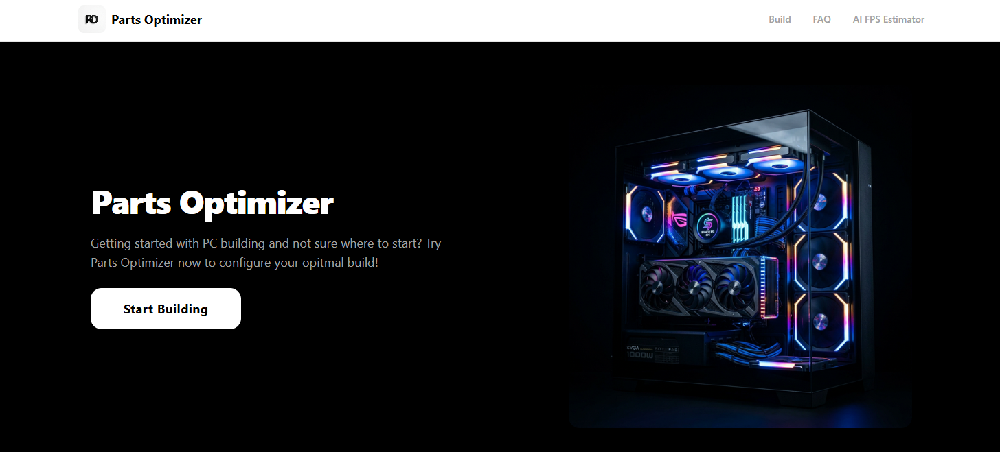
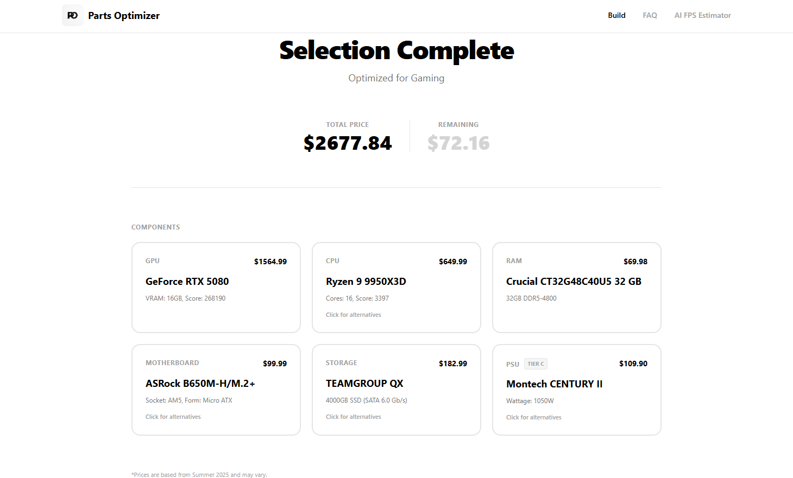
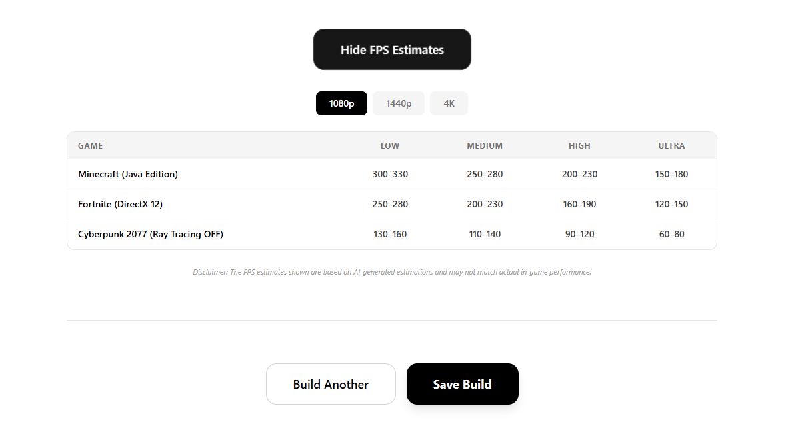

# Parts Optimizer

A full-stack PC build recommender for **Gaming**, **Video Editing**, and **Machine Learning**. Enter a budget to get a six-component build, a price breakdown, and compatible alternative suggestions.

Built with React, TypeScript, FastAPI, SQLAlchemy, and PostgreSQL.

## Features

- Recommend components using budget percentages and use case heuristics.
- Display component specifications and benchmark data.
- Suggest alternative components.
- Export a build to PDF.
- Request estimated gaming performance at 1080p, 1440p, and 4K.
- Estimate FPS separately by selecting a CPU, GPU, and game.

## Technology

| Layer | Tools |
| --- | --- |
| Frontend | React, TypeScript, Vite, Tailwind CSS |
| Backend | Python, FastAPI, Pydantic |
| Data access | SQLAlchemy, PostgreSQL |
| Containers | Docker Compose, Nginx |

## How recommendations work

1. Calculate component spending targets from the budget and use case.
2. Pick the highest-scoring CPU within its share whose socket has a priced motherboard in the catalogue: multi-core score for Video Editing, single-core score otherwise.
3. Choose the cheapest motherboard for that CPU which has compatible RAM. Pick the highest-capacity, fastest compatible RAM within its share; if none fits that share, choose the cheapest compatible RAM. Check memory type, slots, and motherboard capacity.
4. Pick GPU and SSD within their shares. If no GPU fits its share, choose the cheapest eligible GPU. Spend any remaining money on CPU/GPU upgrades in use-case priority order. GPU selection ranks VRAM first for Machine Learning and benchmark score first otherwise, with no VRAM thresholds. A CPU upgrade selects a compatible motherboard and RAM again.
5. Calculate power requirements from the final CPU and GPU, then select the cheapest adequate PSU from the accepted tiers.
6. Fetch compatible alternatives and format the response.

## Getting Started

Clone the repo and run:

~~~bash
docker compose up --build
~~~
